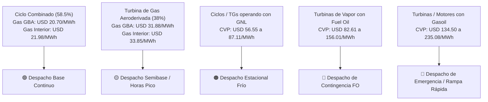

# Estudio de Mercado de Precios Competitivos: Gas Natural y Combustibles para Generación Térmica en Argentina (MEM 2025–2026)

## 1. Resumen Ejecutivo y Tesis de Mercado
Bajo el nuevo marco regulatorio instituido por el **Decreto PEN N.º 450/2025** y la **Resolución SE N.º 400/2025**, el Mercado Eléctrico Mayorista (MEM) argentino transita hacia la desregulación comercial y la cesación del rol centralizado de CAMMESA como compradora única de combustibles. 

Las centrales generadoras térmicas pasan de ser tomadoras pasivas de insumos a responsables directas de su aprovisionamiento de **Gas Natural**, **Gasoil Industrial (Grado 2 y 3)** y **Fuel Oil N.º 6**. Aquellas empresas que logren optimizar su curva de costos de abastecimiento reducen directamente su **Costo Variable de Producción (CVP)**, ganando prioridad en el **despacho por orden de mérito de CAMMESA** y maximizando su margen neto de contribución.

---

## 2. Benchmark de Precios Competitivos por Cuenca y Combustible

### A. Gas Natural en Punto de Ingreso al Sistema de Transporte (PIST)

| Cuenca Productiva | Verano (Oct–Abr) (USD/MMBtu) | Invierno (May–Sep) (USD/MMBtu) | Promedio Ponderado (USD/MMBtu) | Rango Subasta MEGSA Spot (USD/MMBtu) | Dinámica Operativa |
| :--- | :---: | :---: | :---: | :---: | :--- |
| **Cuenca Neuquina (Vaca Muerta)** | **2,15 – 2,40** | **3,50 – 4,20** | **2,83** | 2,10 – 3,20 | Sobreoferta estructural en verano; cuello de botella de transporte en picos invernales. |
| **Cuenca Austral (Tierra del Fuego)** | **2,00 – 2,30** | **3,20 – 3,60** | **2,62** | 1,95 – 2,90 | Producción marina (offshore) de alto factor de carga (Proyecto Fénix en operación). |
| **Cuenca Noroeste (NOA)** | **3,60 – 4,00** | **4,20 – 4,80** | **4,09** | 3,50 – 4,80 | Cuenca en declino severo; sustituida por el gas de Vaca Muerta vía Reversión del Norte. |

### B. Gas Natural Licuado (GNL) de Importación (Terminal Escobar)
- **Fórmula de Paridad**: $P_{\text{GNL, CIF}} = P_{\text{Henry Hub}} + \text{Licuefacción FOB} + \text{Flete Metanero} + \text{Regasificación} + \text{Tasas}$
- **Costo Puesto en Red (Mayo–Agosto)**: **USD 8,50 a USD 12,80 / MMBtu** (Promedio: **USD 9,20 / MMBtu**).
- **Rol en el MEM**: Combustible de sustitución de emergencia en las semanas más frías del año cuando se restringe el gas local a usinas.

### C. Combustibles Líquidos de Respaldo Obligatorio (Back-up)

| Combustible | Unidad Comercial | Refinería Local (USD / Unidad) | Paridad Importación CIF (USD / Unidad) | Costo Equivalente (USD / MMBtu) | Ventaja Importación Directa |
| :--- | :---: | :---: | :---: | :---: | :---: |
| **Gasoil Grado 2 Industrial** | $\text{m}^3$ | **USD 790,00** | **USD 710,00** | **USD 22,07** | **- USD 66,50 / $\text{m}^3$** (en terminal) |
| **Gasoil Grado 3 (Ultra Bajo Azufre)** | $\text{m}^3$ | **USD 855,00** | **USD 765,00** | **USD 23,88** | **- USD 75,00 / $\text{m}^3$** (en terminal) |
| **Fuel Oil N.º 6 (Bajo Azufre)** | Tonelada | **USD 520,00** | **USD 475,00** | **USD 13,37** | **- USD 29,80 / Ton** (en terminal) |

---

## 3. Impacto en el Costo Variable de Producción (CVP) según Tecnología

La ecuación que determina el costo variable de generación en el despacho de CAMMESA es:
$$\text{CVP} \left[\frac{\text{USD}}{\text{MWh}}\right] = \text{Heat Rate} \left[\frac{\text{MMBtu}}{\text{MWh}}\right] \times \text{Costo Combustible Puesto en Planta} \left[\frac{\text{USD}}{\text{MMBtu}}\right] + \text{OPEX Variable}$$

### Tabla de Despacho Térmico Comparativo:

---

## 4. Estrategia de Ahorro y Arbitraje Comercial de Energy CPY
1. **Agregación de Demanda para Contratos Take-or-Pay con Descuento**:
   - Al unificar la demanda de centrales térmicas independientes (ej. MSU Energy, Albanesi, EPEC Pilar), Energy CPY negocia bloques de volumen firme de **$\ge 2.000\text{ dam}^3/\text{día}$** con operadoras de Vaca Muerta, logrando ahorros de **USD 0,15 a USD 0,45 / MMBtu** frente a compras spot dispersas.
2. **Arbitraje Estacional Verano-Invierno**:
   - Acuerdos de suministro flexible con cláusulas de entrega garantizada en verano a precios de oportunidad ($\approx \text{USD } 2,20\text{/MMBtu}$) combinados con swaps de capacidad de transporte firme.
3. **Optimización de Respaldo Líquido (Pool de Licitación Privada)**:
   - Importación consolidada de cargamentos de Gasoil y Fuel Oil puestos en terminales portuarias (Dock Sud y Campana), capturando un spread de hasta **USD 66,50 / $\text{m}^3$** frente al surtidor/refinería spot.
