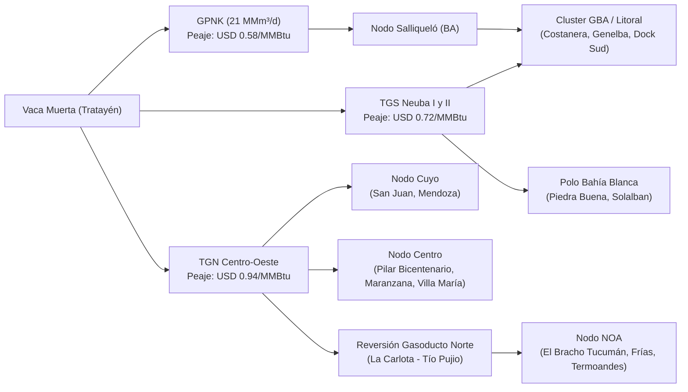

# Análisis Integral de Logística Interna y de Importación para el MEM

## 1. Topología del Sistema Logístico de Combustibles en Argentina

El abastecimiento de las centrales térmicas argentinas se bifurca en dos grandes cadenas logísticas según la naturaleza del combustible y el origen del recurso:
1. **Cadena Gaseosa Interna**: Transporte continuo por gasoductos troncales regulados por **ENARGAS**.
2. **Cadena Líquida y de GNL (Bimodal / Intermodal)**: Vía fluvial/marítima hasta puertos fluviales y marítimos, almacenamiento en tanques de terminal y flete final carretero en camión cisterna.

---

## 2. Logística Interna de Gas Natural: Gasoductos Troncales

### Tabla Comparativa de Sistemas de Transporte Troncal:

| Gasoducto Troncal | Operador | Capacidad de Evacuación | Peaje ENARGAS (Promedio) | Destinos Principales de Generación |
| :--- | :---: | :---: | :---: | :--- |
| **GPNK (Néstor Kirchner / Perito Moreno)** | ENARSA / TGS | $21,0\text{ MMm}^3/\text{día}$ | **USD 0,58 / MMBtu** | Tratayén ➔ Salliqueló; inyección masiva al anillo GBA. |
| **TGS (Neuba I, II y San Martín)** | TGS S.A. | $85,0\text{ MMm}^3/\text{día}$ | **USD 0,72 / MMBtu** | Bahía Blanca, Mar del Plata, AMBA Sur (Dock Sud, Genelba). |
| **TGN (Centro-Oeste y Norte)** | TGN S.A. | $60,0\text{ MMm}^3/\text{día}$ | **USD 0,94 / MMBtu** | Litoral (San Nicolás), Córdoba (Pilar, Maranzana), Tucumán (El Bracho). |

---

## 3. Logística de Combustibles Líquidos: Refinería vs. Importación Portuaria

### A. Estructura de Costos de la Importación Marítima (Hasta Muelle / Tanque)
Para combustibles líquidos (Gasoil Grado 2/3 y Fuel Oil N.º 6) adquiridos en el mercado internacional (Golfo de México, Europa o Brasil):
- **Precio FOB Origen**: Precio de cotización Platts / Argus.
- **Flete Marítimo (MR Tanker / Handymax 35.000–45.000 DWT)**: **USD 42,50 / Tonelada**.
- **Seguro Marítimo**: **0,45% sobre valor CIF**.
- **Peaje Hidrovía / Vía Navegable Troncal**: **USD 3,06 / TRB** (para buques que ascienden por el Río Paraná hacia Campana/San Nicolás).
- **Servicios de Practicaje, Remolque y Amarre**: **USD 18.500 / escala**.
- **Almacenamiento en Tanque de Terminal**: **USD 6,20 / $\text{m}^3\text{-mes}$**.
- **Carga y Despacho a Camión Cisterna**: **USD 2,80 / $\text{m}^3$**.
- **Costo Total de Internación en Muelle**: $\approx \text{USD } 13,50 / \text{m}^3$ en Gasoil y $\approx \text{USD } 15,20 / \text{Ton}$ en Fuel Oil.

### B. Análisis de Puertos y Terminales Estratégicas

| Puerto / Terminal | Calado Máximo | Capacidad Tanques | Buques Admisibles | Centrales Térmicas Beneficiadas Directas |
| :--- | :---: | :---: | :---: | :--- |
| **Puerto Dock Sud (CABA/BA)** | 33 pies | $450.000\text{ m}^3$ | MR Tanker | CT Costanera (muelle propio), CT Dock Sud, CT Genelba (75 km). |
| **Puerto Campana / Zárate** | 34 pies | $380.000\text{ m}^3$ | Handymax / MR | CT Genelba, CT Barker, CT Bragado, usinas mediterráneas. |
| **Puerto San Nicolás (Río Paraná)** | 32 pies | $120.000\text{ m}^3$ | Handymax / Barcazas | CT San Nicolás (muelle propio), CT General Rojo (MSU, 40 km). |
| **Puerto Bahía Blanca (Galván)** | 45 pies (Aguas Profundas)| $280.000\text{ m}^3$ | Panamax / Aframax | CT Piedra Buena (muelle propio), CT Solalban, CT Loma de la Lata. |

---

## 4. Logística Terrestre Capilar: Flete en Camión Cisterna

- **Unidad de Transporte**: Camión cisterna semirremolque de 30 a 36 $\text{m}^3$ (Gasoil) o 28 a 32 Ton (Fuel Oil con serpentín de calefacción).
- **Tarifa Base Carretera**: **USD 0,095 / $\text{m}^3\text{-km}$** (USD 0,11 / Ton-km para Fuel Oil).

### Comparativa de Costo Puesto en Planta (Refinería Local vs. Importación):

| Central Destino | Distancia a Puerto | Gasoil Local (Refinería + Flete) [USD/m³] | Gasoil Importado (CIF + Terminal + Flete) [USD/m³] | Ahorro Neto Importación [USD/m³] |
| :--- | :---: | :---: | :---: | :---: |
| **CT General Rojo (San Nicolás)** | 40 km | USD 793,80 | **USD 727,30** | **USD 66,50** |
| **CT Genelba (Marcos Paz)** | 75 km | USD 797,13 | **USD 730,63** | **USD 66,50** |
| **CT Modesto Maranzana (Río Cuarto)**| 380 km | USD 826,10 | **USD 759,60** | **USD 66,50** |
| **CT Barker (Benito Juárez)** | 420 km | USD 829,90 | **USD 763,40** | **USD 66,50** |
| **CT Frías (Santiago del Estero)** | 710 km | USD 857,45 | **USD 790,95** | **USD 66,50** |

> [!TIP]
> **Conclusión Logística Clave**:  
> El flete carretero impacta de forma idéntica sobre el producto local o importado desde los mismos nodos de despacho (Campana / San Nicolás / Dock Sud). En consecuencia, **la ventaja de costo de la importación CIF en muelle (spread de USD 80 / $\text{m}^3$ bruto, USD 66,50 / $\text{m}^3$ neto de gastos portuarios) se mantiene intacta en todo el territorio nacional**, haciendo altamente rentable el servicio de aprovisionamiento de buques coordinado por Energy CPY.
