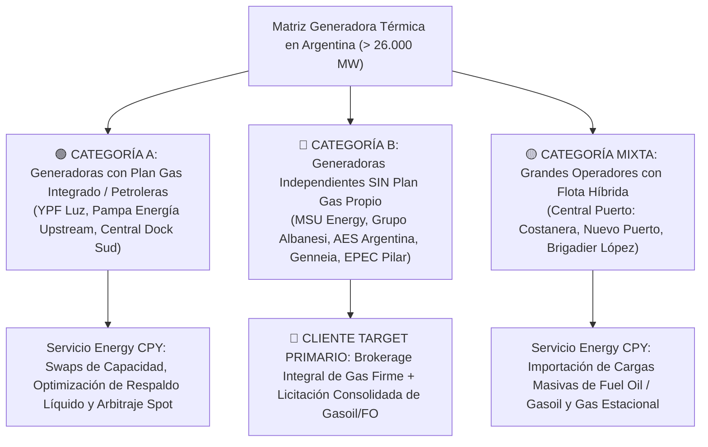

# Directorio Nacional de Empresas Generadoras: Segmentación Plan Gas y Clientes Target

## 1. Mapeo y Segmentación de la Matriz Generadora Térmica en Argentina

En el Mercado Eléctrico Mayorista (MEM), el parque de generación térmica totaliza más de **26.000 MW de potencia instalada**, representando entre el **50% y el 65% de la matriz de generación eléctrica argentina** según la hidraulicidad del año.

Bajo la **Resolución SE N.º 400/2025**, las empresas generadoras se dividen en dos grandes categorías contractuales frente al aprovisionamiento de gas natural:

---

## 2. Segmentación Detallada de Grupos Generadores

### Grupo 1: Generadoras Independientes SIN Plan Gas Propio (Clientes Target Primarios)
Estas empresas son generadores eléctricos puros: no poseen activos de exploración ni producción (E&P) en Vaca Muerta ni en la Cuenca Austral. Compran su gas en el mercado libre o subastas de MEGSA y están 100% expuestas a la volatilidad de precios y costos de transporte.

| Empresa / Grupo | Potencia Térmica Total | Centrales Clave | Tecnología | Consumo Gas Pico (dam³/día) | Prioridad Brokerage Energy CPY | Ahorro Potencial Anual (USD) |
| :--- | :---: | :--- | :--- | :---: | :---: | :---: |
| **MSU Energy S.A.** | **750 MW** | • General Rojo (250 MW) • Barker (250 MW) • Villa María (250 MW) | 3 Ciclos Combinados de alta eficiencia (GE) | 2.550 dam³/d | **MÁXIMA (Target 1)** | **USD 8.916.257** |
| **Grupo Albanesi** | **1.650 MW** | • Modesto Maranzana (350 MW) • Frías (120 MW) • Independencia (120 MW) • Ezeiza (150 MW) • Solalban (120 MW) • Roca (130 MW) | Ciclos Combinados y Turbinas de Gas aeroderivadas | 3.170 dam³/d | **MÁXIMA (Target 2)** | **USD 19.615.765** |
| **AES Argentina** | **1.050 MW** | • San Nicolás (650 MW) • Sarmiento (33 MW) | Turbinas de Vapor (Gas/FO/Carbón) y Turbogas | 1.920 dam³/d | **ALTA (Target 3)** | **USD 12.482.760** |
| **EPEC (Córdoba)** | **580 MW** | • Pilar Bicentenario (466 MW) • Dean Funes (60 MW) • Bazán (54 MW) | Ciclo Combinado (GE) y Turbinas de Gas | 1.830 dam³/d | **ALTA (Ecosistema Local)** | **USD 6.895.239** |
| **Genneia (Térmica)** | **280 MW** | • Bragado I y II (118 MW) • Matheu (42 MW) • Pinamar (35 MW) | Turbinas de Gas y Motores de Punta | 700 dam³/d | **ALTA (Nicho de Margen)** | **USD 3.328.736** |

---

### Grupo 2: Grandes Grupos Mixtos y con Flota Multicombustible
| Empresa / Grupo | Potencia Térmica Total | Centrales Clave | Estatus Plan Gas | Situación de Abastecimiento | Ahorro Potencial Anual (USD) |
| :--- | :---: | :--- | :--- | :--- | :---: |
| **Central Puerto S.A.** | **4.350 MW** | • Costanera (2.324 MW) • Nuevo Puerto (1.010 MW) • Genelba (1.253 MW) • Brigadier López (420 MW) • San Lorenzo (330 MW) | Mixta (Tiene contratos Plan Gas pero requiere compras masivas spot y respaldo líquido) | La mayor compradora privada de combustible de Argentina. Demanda masiva de Fuel Oil N.º 6 en Costanera y gasoil en Brigadier López. | **USD 51.714.290** |
| **Central Dock Sud S.A.** | **900 MW** | • Central Dock Sud (900 MW) | Plan Gas indirecto (Accionistas PAE e YPF Luz) | Ciclo Combinado de alta eficiencia en el puerto de Dock Sud. Compras de oportunidad y respaldo. | **USD 10.699.508** |

---

### Grupo 3: Generadoras Integradas Upstream (Petroleras Propias)
| Empresa / Grupo | Potencia Térmica Total | Centrales Clave | Estatus Plan Gas | Rol en la Estrategia Energy CPY | Ahorro Potencial Anual (USD) |
| :--- | :---: | :--- | :--- | :--- | :---: |
| **Pampa Energía S.A.** | **2.400 MW** | • Loma de la Lata (600 MW) • Genelba Plus (Marcos Paz) • Piedra Buena (620 MW) | **Productor Integrado** (El Mangrullo / Sierra Chata) | Proveedor estratégico de gas PIST. Cliente para optimización de Fuel Oil en Piedra Buena (Bahía Blanca). | **USD 28.532.022** |
| **YPF Luz** | **2.500 MW** | • Complejo El Bracho (1.300 MW) • Loma Campana (210 MW) • La Plata Cogeneración (270 MW) | **Productor Integrado** (YPF S.A.) | Abastecido por YPF. Oportunidad en swaps de transporte TGN/TGS y derivados especiales. | **USD 29.720.856** |

---

## 3. Síntesis de Potencial Comercial y Cuota de Mercado

- **Potencia Térmica Total Mapeada**: **14.760 MW** (los 9 principales grupos del país).
- **Consumo Anual Estimado del Clúster**:
  - Gas Natural: **$\approx 350.000.000\text{ MMBtu / año}$**
  - Gasoil Grado 2/3: **$\approx 850.000\text{ m}^3\text{ / año}$**
  - Fuel Oil N.º 6: **$\approx 700.000\text{ Ton / año}$**
- **Pool Total de Ahorro Económico Capturable**: **USD 171.905.433 / año**.
- **Potencial de Honorarios para Energy CPY (Shared Savings 10%)**: **USD 17.190.543 / año**.

> [!IMPORTANT]
> **Prioridad de Abordaje Comercial Inmediato**:  
> Comenzar el roadshow de presentación y firma de convenios de confidencialidad (NCNDA) y corretaje con **MSU Energy S.A.** (Hernán Rossi / Gerencia de Combustibles) y **Grupo Albanesi** (Gerencia Comercial / Contratación de Gas), presentando la oferta estructurada de gas firme de Vaca Muerta con descuento y el pool de importación de gasoil para usinas mediterráneas.
