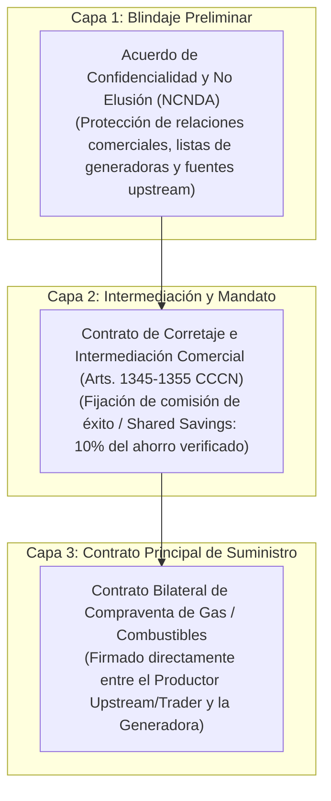

# Marco Regulatorio (Decreto 450/2025, Res. SE 400/2025) y Estructura Legal de Brokerage

## 1. El Nuevo Paradigma Regulatorio en Argentina (2025–2026)

### A. Decreto PEN N.º 450/2025 (Texto Ordenado Leyes 15.336 y 24.065)
El Decreto 450/2025, dictado bajo las facultades delegadas de la **Ley de Bases N.º 27.742**, restituye los principios rectores de desregulación y libre competencia del marco regulatorio de los años 90, adaptándolo al escenario energético actual:
1. **Normalización del MEM**: Establece un período de transición de **24 meses** para normalizar el funcionamiento del mercado.
2. **Rol Estricto de CAMMESA como OED**: CAMMESA cesa su rol histórico de intermediario y comprador centralizado de combustibles para las generadoras, volviendo a su función técnica estricta de **Organismo Encargado del Despacho (OED)**.
3. **Responsabilidad de Abastecimiento Privado**: Las generadoras térmicas deben asumir el riesgo y la gestión comercial de contratación de su gas natural y combustibles líquidos de respaldo.

### B. Resolución SE N.º 400/2025: Reglas de Transición y Mecanismos de Gas
La Resolución 400/2025 operativiza la transición comercial fijando los siguientes esquemas:
- **"GN Acuerdo" (Régimen Transitorio Asistido)**: Mecanismo donde CAMMESA/ENARSA canalizan temporalmente gas de los contratos vigentes del Plan Gas.Ar hacia generadoras térmicas spot que aún no han contratado combustible propio.
- **"GN Propio" (Contratación Privada Desregulada)**: Habilita a cualquier generadora a contratar directamente gas en boca de pozo (PIST) o en mercado spot con productores y comercializadores. Aquellas generadoras con "GN Propio" eficiente tienen prioridad de despacho y retienen íntegramente las ganancias generadas por sus menores costos de abastecimiento.
- **Retiro de Volúmenes del Plan Gas**: Los productores de gas (YPF, PAE, Tecpetrol, Pampa, Total) están autorizados a retirar volúmenes comprometidos en el Plan Gas.Ar para destinarlos a contratos bilaterales directos con generadoras térmicas.

---

## 2. Estructura Jurídica y Contractual de Energy CPY (Estrategia en 3 Capas)

Para operar de forma blindada, bancable y sin asumir riesgos de toma física de producto (sin quedar expuesta a penalidades por desbalances de gasoducto o fluctuaciones de precio de commodities), Energy CPY estructura sus operaciones bajo la **Estrategia Legal en Tres Capas** amparada en el **Código Civil y Comercial de la Nación (Ley 26.994)**:

### Detalle de las Tres Capas:

1. **Capa 1 — Convenio de Confidencialidad y No Elusión (NCNDA)**:
   - Se firma previamente con la Generadora y con el Productor Upstream / Trader internacional.
   - Establece un plazo de vigencia de 24 a 36 meses, protegiendo las listas de precios, estructuras de costos y la identidad de las partes para impedir la elusión del intermediario.

2. **Capa 2 — Contrato de Corretaje Comercial y Mandato de Abastecimiento**:
   - Encuadrado en los **Artículos 1345 a 1355 del Código Civil y Comercial de la Nación (Contrato de Corretaje)**.
   - **Esquema de Retribución Mixto**:
     - *Modelo A (Comisión Fija por Volumen)*: **USD 0,03 a USD 0,06 por MMBtu** de gas entregado; **USD 3,00 a USD 6,00 por $\text{m}^3$** de gasoil.
     - *Modelo B (Ahorro Compartido / Shared Savings)*: **8% al 12% del ahorro neto verificado** respecto del precio de referencia de CAMMESA / subasta MEGSA del mes.

3. **Capa 3 — Contrato Marco de Suministro de Combustible**:
   - Suscripto directamente entre el Productor Petrolero / Trader y la Generadora Térmica.
   - Energy CPY figura como intermediario legitimado en la cláusula de corretaje. La generadora efectúa el pago directo al proveedor, y la retención/pago de la comisión de Energy CPY se liquida mensualmente con factura de servicios.

---

## 3. Hoja de Ruta Operativa y Próximos Pasos Comerciales

1. **Kick-Off Comercial**: Emisión de la carta de presentación institucional y resumen ejecutivo bancable hacia **MSU Energy** y **Grupo Albanesi**.
2. **Reunión de Diagnóstico**: Relevar el perfil estacional de consumo 2026 y los puntos de entrega de gas (TGN Centro-Oeste / TGS Neuba).
3. **Compulsa con Productores**: Solicitar ofertas en PIST a Tecpetrol, TotalEnergies, PAE y productores independientes para estructurar el paquete de gas en bloque.
4. **Cierre de Contrato Piloto**: Formalizar la primera operación de suministro para la temporada otoño-invierno 2026.
