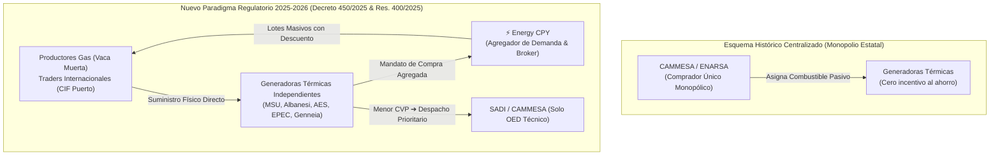
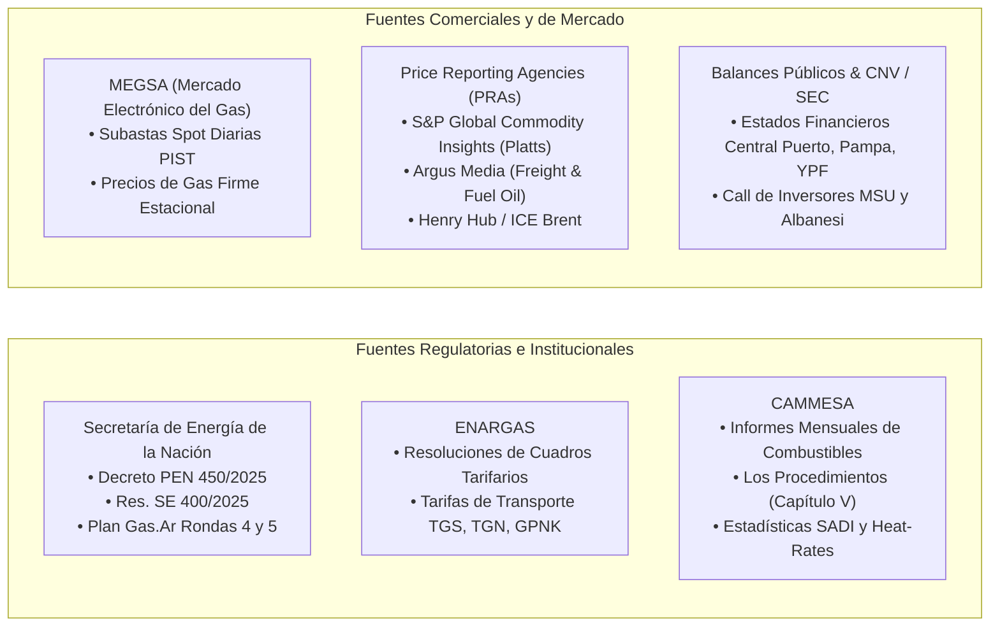
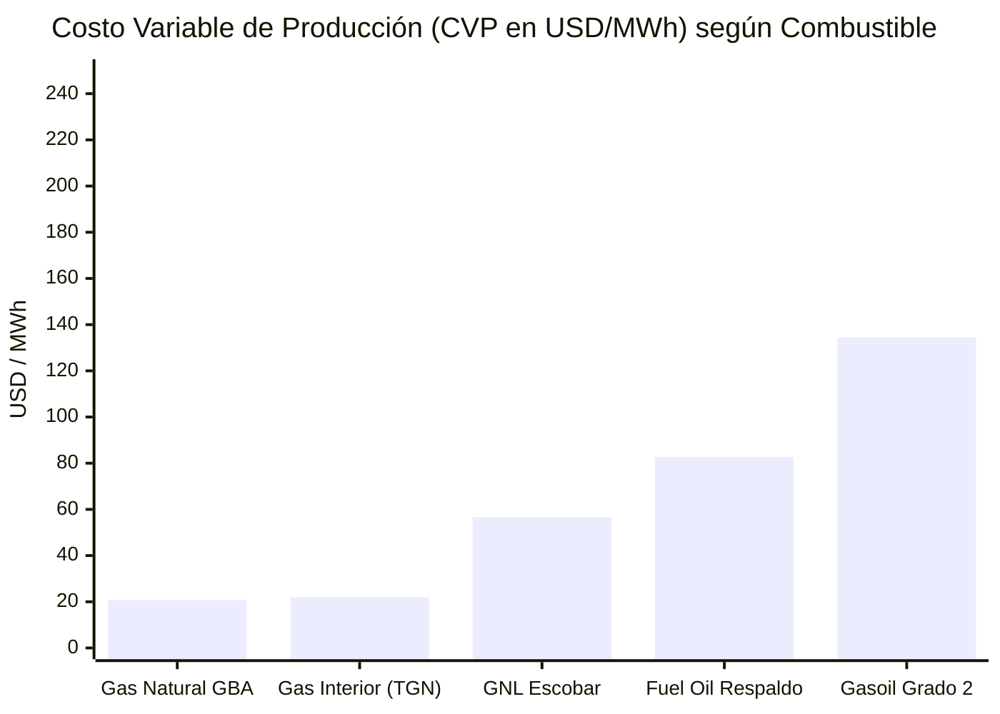
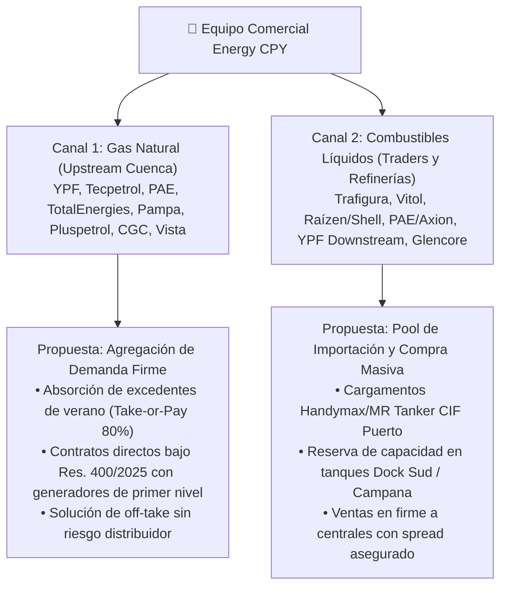
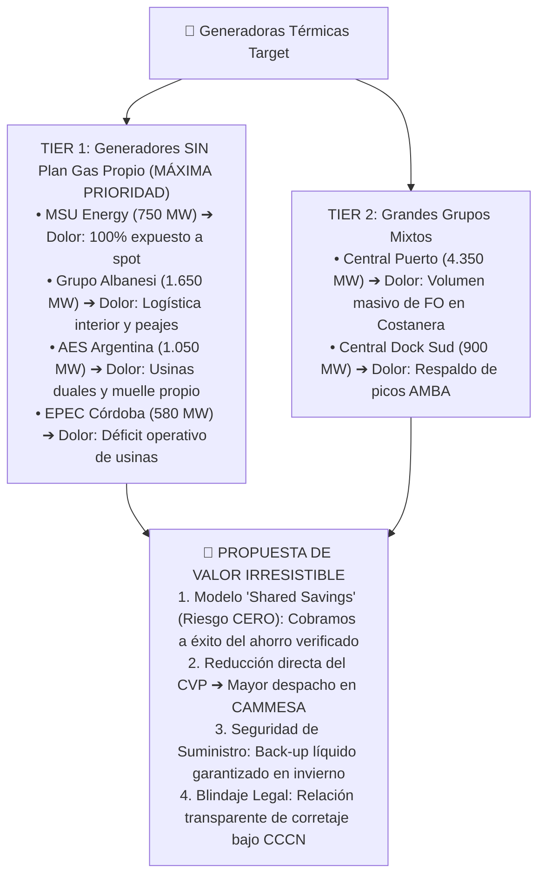
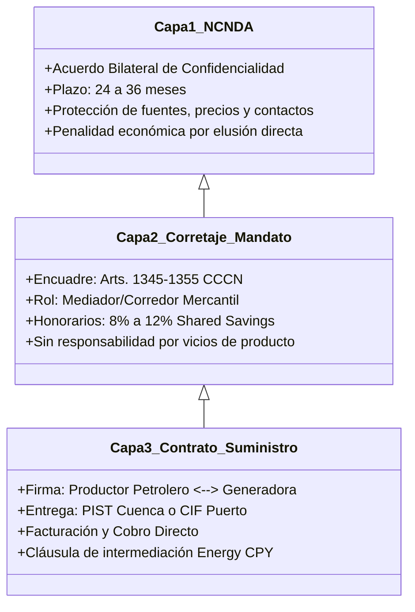
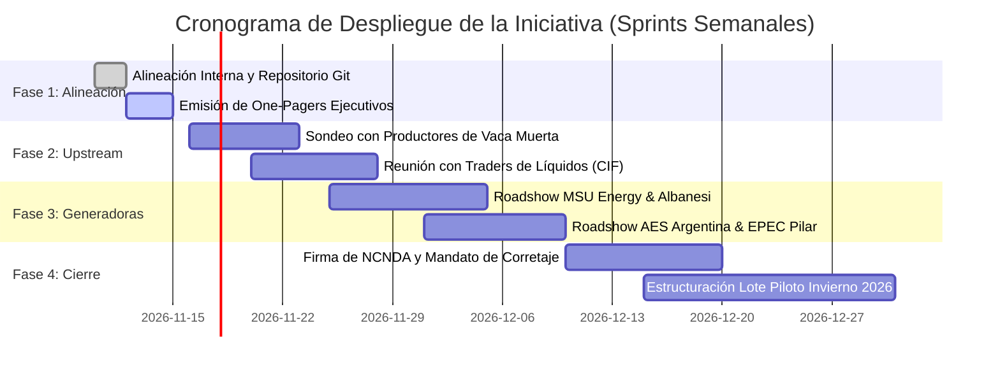

# ⚡ DOSSIER ESTRATÉGICO DE LA INICIATIVA: ABASTECIMIENTO Y BROKERAGE DE GAS NATURAL Y COMBUSTIBLES PARA GENERADORAS EN EL MEM

> **Documento de Trabajo y Alineación Estratégica del Equipo**  
> **Proyecto**: Plataforma de Abastecimiento y Brokerage de Combustibles y Gas para Centrales Térmicas  
> **Holding / Organización**: Energy CPY (`inventarioenergycpy`)  
> **Fecha de Emisión**: Noviembre 2026  
> **Ámbito de Aplicación**: Mercado Eléctrico Mayorista (MEM) — República Argentina  
> **Marco Regulatorio Troncal**: Decreto PEN N.º 450/2025, Resolución SE N.º 400/2025 y Ley de Bases N.º 27.742  

---

## 📑 ÍNDICE GENERAL

1. [Resumen Ejecutivo & Tesis de Inversión](#1-resumen-ejecutivo--tesis-de-inversión)
2. [Fuentes Oficiales y Verídicas de Información](#2-fuentes-oficiales-y-verídicas-de-información)
3. [Indicadores Clave de Mercado, Gráficas y Tendencias](#3-indicadores-clave-de-mercado-gráficas-y-tendencias)
4. [Playbook de Negociación con Proveedores Upstream y Traders](#4-playbook-de-negociación-con-proveedores-upstream-y-traders)
5. [Playbook de Negociación con Empresas Generadoras (Clientes Target)](#5-playbook-de-negociación-con-empresas-generadoras-clientes-target)
6. [Estructura Jurídica Blindada en Tres Capas (CCCN Ley 26.994)](#6-estructura-jurídica-blindada-en-tres-capas-cccn-ley-26994)
7. [Plan de Acción Inmediato y Hoja de Ruta para el Equipo de Trabajo](#7-plan-de-acción-inmediato-y-hoja-de-ruta-para-el-equipo-de-trabajo)

---

## 1. RESUMEN EJECUTIVO & TESIS DE INVERSIÓN

### 1.1. La Gran Oportunidad: El Fin de la Compra Centralizada de CAMMESA
Durante más de dos décadas, el Estado Nacional a través de **CAMMESA** (y anteriormente ENARSA) asumió de manera centralizada la compra y suministro de gas natural, gasoil, fuel oil y GNL para el parque generador térmico de la Argentina. Este esquema congeló la competencia, generó ineficiencias de contratación y transformó a las centrales en operadores pasivos que recibían el combustible sin incentivos económicos para optimizar su precio.

A partir de la promulgación del **Decreto PEN N.º 450/2025** (que actualiza las Leyes 15.336 y 24.065) y la publicación de la **Resolución SE N.º 400/2025**, el Gobierno Nacional determinó un **período de transición de 24 meses** para normalizar el MEM:
1. **CAMMESA retorna estrictamente a su rol técnico de Organismo Encargado del Despacho (OED)**, cesando su intermediación comercial en combustibles.
2. **Las generadoras térmicas deben aprovisionarse por cuenta propia** en el mercado abierto de gas natural y combustibles líquidos de respaldo.
3. Se crea el régimen de **"GN Propio"** vs. el régimen transitorio asistido de **"GN Acuerdo"**: las generadoras que consigan combustible propio más barato optimizan directamente su **Costo Variable de Producción (CVP)**, ganan prioridad en el **despacho por orden de mérito horario** y **retienen íntegramente el 100% del ahorro económico**.



### 1.2. Magnitud Económica del Negocio
- **Universo de Potencia Analizado**: **14.760 MW térmicos** distribuidos en 9 grupos generadores y más de 25 centrales térmicas.
- **Consumo Anual Estimado**:
  - Gas Natural: $\approx 350.000.000\text{ MMBtu / año}$ ($\approx 35\text{ MMm}^3/\text{día}$ promedio).
  - Gasoil Grado 2/3: $\approx 850.000\text{ m}^3\text{ / año}$ (respaldo de picos e invierno).
  - Fuel Oil N.º 6 Bajo Azufre: $\approx 700.000\text{ Ton / año}$ (grandes calderas portuarias).
- **Pool de Ahorro Neto Anual Detectado**: **USD 171.905.433 / año**.
- **Potencial de Honorarios para Energy CPY (Shared Savings 10%)**: **USD 17.190.543 / año**.

---

## 2. FUENTES OFICIALES Y VERÍDICAS DE INFORMACIÓN

Para sostener negociaciones bancables frente a directorios de empresas multinacionales, bancos y comités de riesgo, toda la información de este proyecto proviene de fuentes primarias rigurosamente verificadas:



1. **Secretaría de Energía de la Nación (MinEco)**:
   - **Decreto PEN N.º 450/2025**: Texto ordenado y desregulación del MEM.
   - **Resolución SE N.º 400/2025**: Normas de transición, esquemas de "GN Acuerdo" vs "GN Propio", y autorización a productoras para retirar volumen de Plan Gas para acuerdos directos.
   - **Pliegos y Adjudicaciones Plan Gas.Ar (Decretos 892/20 y 730/22)**: Precios de referencia contractuales hasta diciembre 2028.
2. **CAMMESA (Compañía Administradora del Mercado Mayorista Eléctrico S.A.)**:
   - Informes Mensuales de la Programación Estacional, Despacho y Combustibles (series 2023–2026).
   - "Los Procedimientos para la Programación de la Operación, el Despacho de Cargas y el Cálculo de Precios" (Anexos 24, 25 y Capítulo V).
   - Datos de rendimiento específico (*Heat Rates*) y consumo específico por máquina del SADI.
3. **ENARGAS (Ente Nacional Regulador del Gas)**:
   - Cuadros tarifarios vigentes de transporte de gas natural correspondientes a las licenciatarias TGS S.A. y TGN S.A., y peajes de acceso al GPNK.
4. **MEGSA (Mercado Electrónico del Gas S.A.)**:
   - Registros de subastas electrónicas spot diarias e interrumpibles por cuenca (Neuquina, Austral, Noroeste).
5. **Agencias Internacionales de Precios e Inteligencia Logística**:
   - *S&P Global Platts* (Paridades de importación CIF Buenos Aires / Santos de Gasoil Ultra Bajo Azufre).
   - *Argus Media* (Mercado global de Fuel Oil 1% y fletes marítimos MR Tanker / Handymax).
   - *U.S. Energy Information Administration (EIA)* (Cotizaciones Henry Hub y fletes GNL).

---

## 3. INDICADORES CLAVE DE MERCADO, GRÁFICAS Y TENDENCIAS

### 3.1. Curva de Precios de Gas Natural en PIST (Punto de Ingreso al Sistema de Transporte)
La Cuenca Neuquina (Vaca Muerta) presenta una **fuerte estacionalidad estructural**: exceso de producción en verano (*flushing*) y saturación de gasoductos en invierno.

```
USD/MMBtu
  5.00 │                                            
  4.50 │                                 ┌─────────┐ (Invierno NOA: USD 4.50)
  4.00 │                   ┌──────────┐  │         │ 
  3.50 │                   │ Neuquina │  │         │ (Invierno Neuquén: USD 3.65 - 4.20)
  3.00 │                   │ Invierno │  │         │ 
  2.50 │      ┌──────────┐ │          │  │         │ 
  2.00 │ ─────│ Neuquina │─│          │──│         │── (Promedio Ponderado: USD 2.83)
  1.50 │      │  Verano  │ │          │  │         │ 
  1.00 │      │(USD 2.25)│ │          │  │         │ 
  0.00 └──────┴──────────┴─┴──────────┴──┴─────────┴────────
               Oct - Abr      May - Sep      NOA Spot
```

- **Verano (Octubre a Abril)**: USD 2,15 a USD 2,40 / MMBtu.
- **Invierno (Mayo a Septiembre)**: USD 3,50 a USD 4,20 / MMBtu.
- **Promedio Anual Base**: **USD 2,83 / MMBtu**.
- **Oportunidad de Arbitraje Energy CPY**: Negociar contratos plurianuales en bloque con cláusula de suministro garantizado de verano a **USD 2,20 / MMBtu** y techos de invierno negociados con operadoras upstream.

### 3.2. Comparativa de Costos Variables de Producción (CVP en USD/MWh) por Tecnología
El gráfico de mérito demuestra que operar con combustibles líquidos cuadruplica o sextuplica el costo de generación respecto del gas natural.



*Valores calculados sobre Ciclo Combinado moderno ($\eta = 58,5\%$ y Heat Rate = $5,83\text{ MMBtu/MWh}$). En turbinas de gas aeroderivadas de ciclo abierto ($\eta = 38\%$), el CVP de gasoil salta a **USD 207,17 / MWh**.*

### 3.3. Tendencias Macro de la Transición 2025–2028
1. **Consolidación de Vaca Muerta**: Con la finalización de la Reversión del Gasoducto Norte y las plantas compresoras de GPNK, la oferta de gas no convencional desplazará definitivamente al gas boliviano y al GNL fuera del invierno duro.
2. **Desregulación del Mercado a Término (MAT)**: Las distribuidoras y grandes usuarios comenzarán a contratar energía libremente con generadoras, obligando a estas a asegurar gas económico para ofrecer contratos PPA atractivos.
3. **Respaldo Térmico Líquido Imprescindible**: Pese al crecimiento de renovables (solar y eólica), el sistema argentino requiere **firmeza térmica**. En invierno, el consumo residencial prioritario corta el gas a las usinas, demandando más de **$1.500.000\text{ m}^3$ de líquidos** para evitar apagones masivos.

---

## 4. PLAYBOOK DE NEGOCIACIÓN CON PROVEEDORES UPSTREAM Y TRADERS

El equipo comercial debe estructurar dos canales diferenciados: **Productores Upstream de Cuenca (Gas Natural)** y **Refinerías / Traders Internacionales (Combustibles Líquidos)**.



### 4.1. Negociación con Productores de Gas Natural (Upstream)
#### A. ¿Qué valor les ofrece Energy CPY? (Nuestra Ventaja)
- **Monetización de Excedentes de Verano**: En temporada estival, Vaca Muerta cierra pozos por falta de demanda (*shut-in*). Energy CPY agrupa demanda de ciclos combinados de base que consumen de forma continua los 365 días del año.
- **Agregación de Contrapartes Solventes**: En lugar de negociar con 5 o 6 generadores por separado (con sus respectivos contratos, garantías y auditorías legales), el productor negocia un contrato estandarizado con un bloque consolidado.
- **Escape Regulatorio**: La Resolución SE 400/2025 autoriza a los productores a retirar volumen del Plan Gas para volcarlos a contratos directos. Venderle a un generador térmico en dólares billete o al tipo de cambio oficial sin retrasos del Tesoro Nacional es más atractivo que depender de las transferencias de subsidios del Estado.

#### B. Términos Contractuales Clave a Negociar
- **Punto de Entrega**: Estrictamente **PIST (Punto de Ingreso al Sistema de Transporte)** en Neuquén (Tratayén / Loma La Lata) o Tierra del Fuego.
- **Estructura de Compromiso**:
  - Cláusula **Take-or-Pay (ToP)** moderada: Máximo **70% a 80%** en base mensual, con derecho a recuperación de gas no tomado (*Make-Up Gas*) en un plazo no menor a 12 meses.
  - Cláusula **Deliver-or-Pay (DoP)**: El productor indemniza a la generadora si no inyecta el gas comprometido, cubriendo el sobrecosto de operar con combustible alternativo (gasoil/fuel oil).
- **Precio y Fórmula de Ajuste**:
  - Precio base verano: **USD 2,20 – 2,35 / MMBtu**.
  - Precio invierno: **USD 3,50 – 3,80 / MMBtu**.
  - Indexación: Fórmula transparente atada a una canasta de gas natural o precio medio ponderado PIST de MEGSA, facturado mensualmente.

---

### 4.2. Negociación con Traders y Refinerías (Líquidos: Gasoil y Fuel Oil)
#### A. ¿Qué valor les ofrece Energy CPY?
- **Volumen de Escala para Cargamentos Completos**: Un cargamento de buque tanque **MR Tanker (Medium Range)** transporta entre **$35.000\text{ y }45.000\text{ m}^3$**. Una sola central mediana no puede absorber este volumen por capacidad de tanques; Energy CPY distribuye el cargamento entre 3 o 4 centrales (ej. Central Puerto Costanera, MSU General Rojo y Albanesi Maranzana).
- **Previsibilidad de Demanda Estacional**: Compromiso de compra anticipado en marzo/abril antes de que los precios de fletes y gasoil se disparen en el invierno internacional.

#### B. Términos Contractuales Clave a Negociar
- **Modalidad de Entrega**: **CIF Puerto Fluvial/Marítimo** (Dock Sud, Campana, San Nicolás o Bahía Blanca) o **DAP Puesto en Tanque de Terminal**.
- **Control de Calidad y Pérdidas**:
  - Inspector independiente de prestigio internacional (*SGS*, *Bureau Veritas* o *Saybolt*) para certificar volumen y calidad (contenido de azufre $\le 10\text{ ppm}$ en Grado 3, $\le 500\text{ ppm}$ en Grado 2; viscosidad cinemática y punto de inflamación en Fuel Oil).
  - Deducción de mermas de transporte marítimo tolerables: máximo **0,3% a 0,5%**.
- **Ventana de Estadía y Demurrages**: Mínimo **72 horas de estadía gratuita** (*laytime*) para descarga para evitar penalidades de demurrage (USD 18.000–22.000/día).

---

## 5. PLAYBOOK DE NEGOCIACIÓN CON EMPRESAS GENERADORAS (CLIENTES TARGET)

Las empresas generadoras son nuestros clientes principales. La estrategia debe ser empática, cuantitativa y centrada en resolver sus principales dolores de cabeza operativos y financieros.



### 5.1. Matriz de Argumentación y Manejo de Objeciones con Generadoras

| Objeción Típica del Directorio / Gerente de Combustibles | Realidad del Mercado (Diagnóstico Antigravity) | Respuesta y Argumento de Cierre de Energy CPY |
| :--- | :--- | :--- |
| *"Nosotros preferimos seguir operando bajo el 'GN Acuerdo' de CAMMESA que es más cómodo."* | El esquema "GN Acuerdo" es transitorio, tiene un recargo administrativo, y asigna gas con menor prioridad que a las centrales con "GN Propio". Además, CAMMESA trasladará los sobrecostos de combustible a las generadoras a partir de 2026. | *"Quedarse en 'GN Acuerdo' te condena a ser despachado al final del orden de mérito. Con nuestro servicio de 'GN Propio', bajamos tu CVP entre 8% y 12%, pasando a despachar en base y capturando márgenes netos superiores."* |
| *"Nuestras gerencias de abastecimiento ya hablan con YPF y PAE directamente."* | Una generadora individual tiene poco poder de negociación en precios de gas estival y no puede negociar cargamentos enteros de buques de gasoil o fuel oil. | *"No reemplazamos a tu gerencia de compras; potenciamos su poder de fuego. Al agregar tu volumen con otros 2.000 MW del sector, obtenemos condiciones de gran cliente mayorista que una central aislada jamás consigue."* |
| *"No queremos asumir compromisos fijos ni pagar honorarios por adelantado en un contexto incierto."* | El riesgo de caja frena las contrataciones independientes. | *"Energy CPY trabaja bajo la modalidad de **Shared Savings (Ahorro Compartido)**: no cobramos ningún anticipo ni costo fijo. Si no generamos un ahorro cuantificable y auditado frente al precio de referencia de CAMMESA/MEGSA, nuestros honorarios son exactamente CERO."* |
| *"¿Cómo garantizan que el gasoil o el gas lleguen a tiempo para evitar multas de indisponibilidad de CAMMESA?"* | Las multas por falla de combustible de CAMMESA son severas y descuentan remuneración de potencia. | *"Estructuramos contratos con cláusula de respaldo cruzado (*Deliver-or-Pay*) con los principales productores de Vaca Muerta y terminales portuarias, asegurando stock permanente en tanques de terminal listos para despacho en camión 24/7."* |

---

### 5.2. Ahorros Cuantitativos Clave por Empresa para el Pitch de Venta

```
┌─────────────────────────────────────────────────────────────────────────────┐
│                   AHORRO ECONÓMICO PROYECTADO POR CLIENTE                   │
├──────────────────────────┬────────────────┬───────────────┬─────────────────┤
│ Empresa Generadora       │ Potencia (MW)  │ Estatus Gas   │ Ahorro Anual    │
├──────────────────────────┼────────────────┼───────────────┼─────────────────┤
│ Central Puerto S.A.      │   4.350 MW     │ Mixta         │ USD 51.714.290  │
│ Grupo Albanesi           │   1.650 MW     │ Sin Plan Gas  │ USD 19.615.765  │
│ AES Argentina            │   1.050 MW     │ Sin Plan Gas  │ USD 12.482.760  │
│ Central Dock Sud         │     900 MW     │ Plan Gas Ind. │ USD 10.699.508  │
│ MSU Energy S.A.          │     750 MW     │ Sin Plan Gas  │ USD  8.916.257  │
│ EPEC (Pilar Bicentenario)│     580 MW     │ Sin Plan Gas  │ USD  6.895.239  │
│ Genneia (Térmica)        │     280 MW     │ Sin Plan Gas  │ USD  3.328.736  │
├──────────────────────────┴────────────────┴───────────────┼─────────────────┤
│ TOTAL POOL DE MERCADO OBJETIVO                            │ USD 113.652.555 │
│ (Excluyendo usinas con yacimiento propio YPF/Pampa)       │                 │
└───────────────────────────────────────────────────────────┴─────────────────┘
```

---

## 6. ESTRUCTURA JURÍDICA BLINDADA EN TRES CAPAS (CCCN LEY 26.994)

Para garantizar la seguridad patrimonial de Energy CPY, no incurrir en riesgos de balance por toma de producto ni quedar expuestos a contingencias de transporte, toda la relación jurídica se articula bajo la **Estrategia en Tres Capas**:



1. **Capa 1: Acuerdo de Confidencialidad y No Elusión (NCNDA)**:
   - Se firma previamente con la Generadora y con el Productor/Trader.
   - Prohíbe formalmente a las partes contactarse de manera directa eludiendo la intermediación de Energy CPY una vez presentada la oferta técnica o la lista de precios.
2. **Capa 2: Contrato de Corretaje Comercial e Intermediación (Arts. 1345 a 1355 CCCN)**:
   - Otorga mandato expreso a Energy CPY para acercar a las partes y negociar las mejores condiciones de compra.
   - Fija la comisión de éxito (**Shared Savings: 10% del ahorro neto verificado** o comisión fija de **USD 0,03 a USD 0,06 por MMBtu** y **USD 3,00 a USD 5,00 por $\text{m}^3$** de gasoil).
   - Establece que Energy CPY **no adquiere la titularidad física ni jurídica del combustible**, quedando exenta de multas por desbalances ante ENARGAS o CAMMESA.
3. **Capa 3: Contrato Bilateral Principal de Compraventa**:
   - Suscripto directamente entre el Productor Petrolero / Trader Internacional y la Generadora Térmica.
   - El productor factura a la generadora y la generadora abona directamente al productor. En la misma liquidación mensual, la generadora retiene y abona los honorarios devengados a favor de Energy CPY.

---

## 7. PLAN DE ACCIÓN INMEDIATO Y HOJA DE RUTA PARA EL EQUIPO DE TRABAJO



### 7.1. Asignación de Tareas por Especialista del Squad
- **Líder Comercial / Negociador**:
  - Enviar el One-Pager Ejecutivo y solicitar audiencias con las Gerencias de Combustibles de **MSU Energy** y **Grupo Albanesi**.
- **Analista de Inteligencia de Mercado (Agente 01 & 09)**:
  - Mantener actualizada la matriz de precios PIST de MEGSA y paridades de importación semanales en el script [`scripts/analisis_mercado_precios.py`](file:///E:/Proyectos/abastecimiento-combustibles-gas-generadoras/scripts/analisis_mercado_precios.py).
  - Monitorear publicaciones del ENARGAS sobre peajes de la Reversión del Norte.
- **Asesor Legal (Agente 05)**:
  - Preparar el paquete documental estandarizado (modelo NCNDA + modelo Contrato de Corretaje en 3 capas adaptado a cada generadora).
- **Operaciones & Logística (Agente 02)**:
  - Validar disponibilidad de capacidad de almacenaje en las terminales portuarias de Campana y Dock Sud para la reserva de tanques de combustible líquido.

---

### 7.2. Métricas de Éxito y KPIs del Proyecto
1. **Volumen de Demanda Consolidada**: Lograr un mínimo de **$1.500\text{ dam}^3/\text{día}$** de gas natural y **$50.000\text{ m}^3$** de gasoil bajo mandato de corretaje antes del 31 de marzo de 2026.
2. **Spread de Descuento Promedio Capturado**:
   - Gas Natural: $\ge \text{USD } 0,25\text{ / MMBtu}$ por debajo del precio spot de invierno.
   - Gasoil: $\ge \text{USD } 45,00\text{ / m}^3$ por debajo de precio mayorista de refinería local.
3. **Conversión Comercial**: Cerrar al menos **dos contratos marco de suministro piloto** para la temporada invernal 2026.

---

*Dossier oficial consolidado y resguardado en el repositorio central de Energy CPY.*  
*Repositorio GitHub*: [https://github.com/inventarioenergycpy/abastecimiento-combustibles-gas-generadoras](https://github.com/inventarioenergycpy/abastecimiento-combustibles-gas-generadoras)
